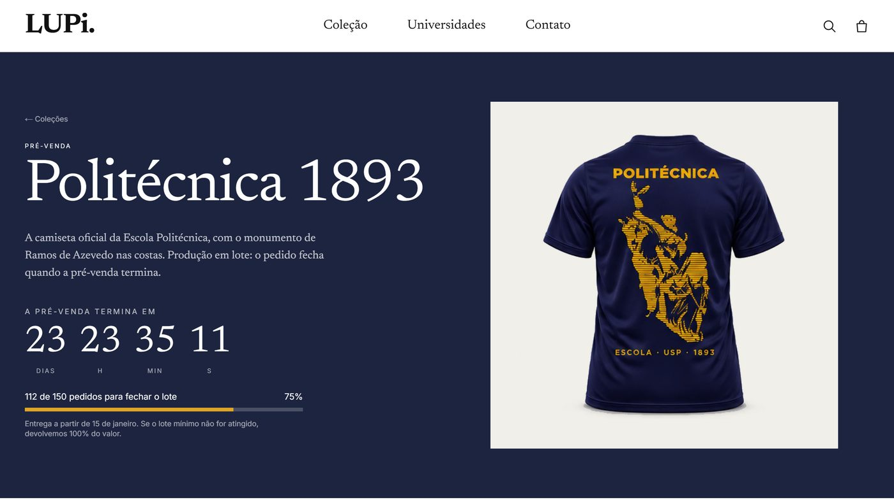
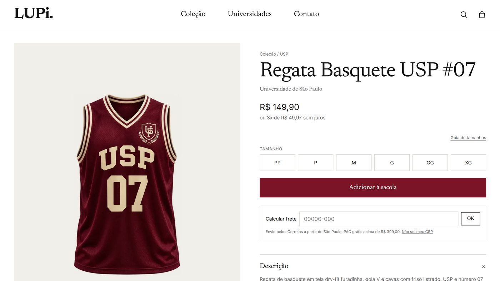
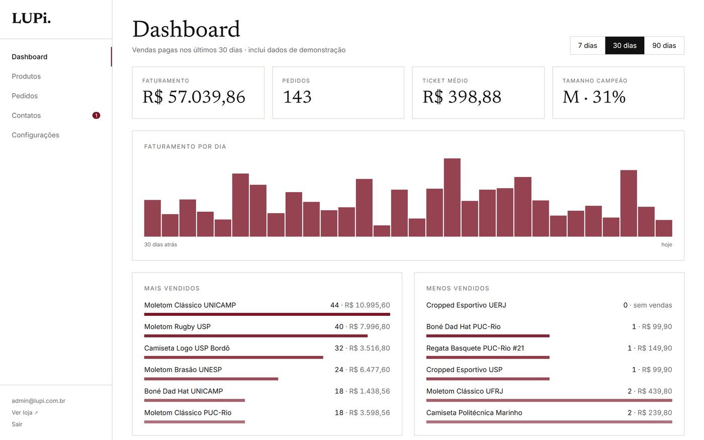
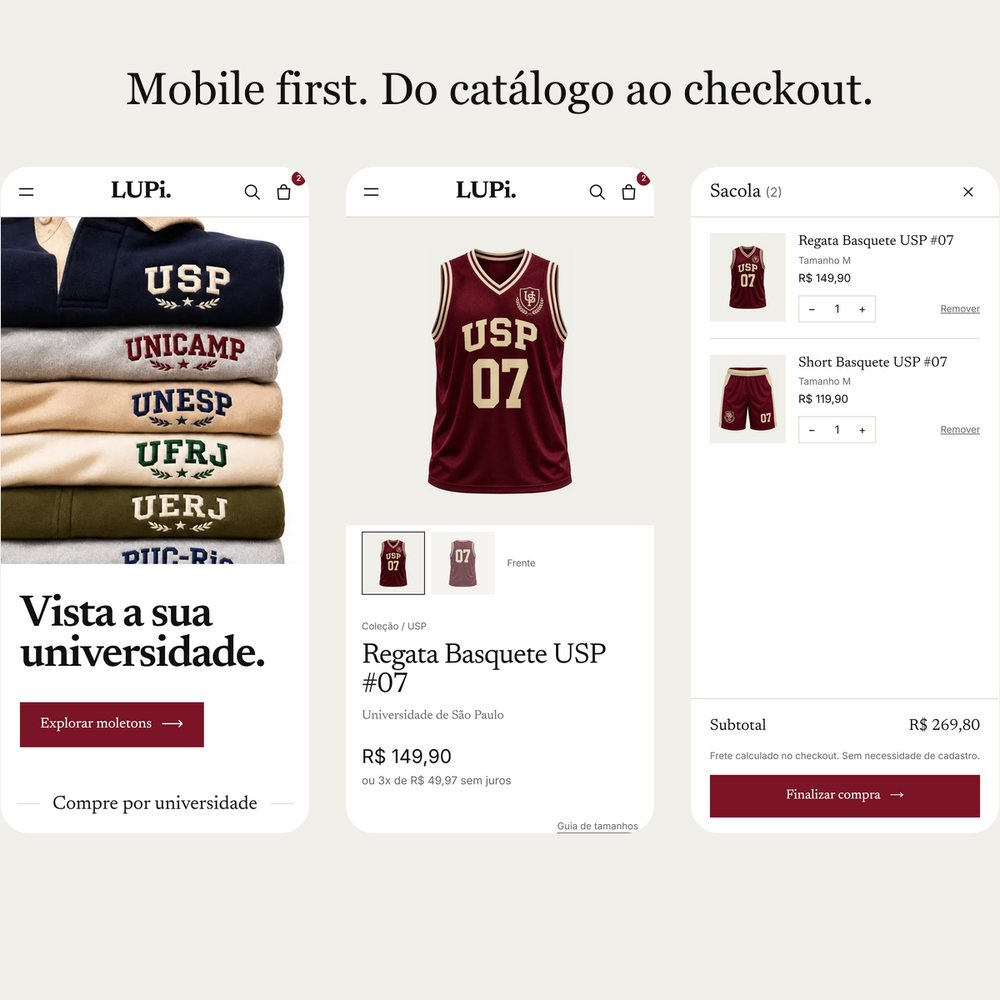

# LUPi.

E-commerce de moda universitária (moletons, camisetas, regatas, shorts, croppeds, toucas e bonés de universidades e atléticas), com painel administrativo para os donos da loja.

Projeto de portfólio, feito como MVP para apresentar a ideia da LUPI a atléticas e centros acadêmicos. Os dados de vendas do painel são fictícios.

**Demo:** https://lupi-store.vercel.app

## Telas










## O que o sistema faz

**Loja (não exige login para comprar)**
- Home, catálogo com filtros (universidade, tipo de peça, desconto), busca e ordenação por preço
- Página de produto com galeria frente/costas, guia de tamanhos e cálculo de frete por CEP
- Sacola salva no navegador e checkout como visitante
- Frete PAC e SEDEX por região do CEP (estimativa nos moldes da tabela dos Correios) e endereço preenchido pelo ViaCEP
- Pagamento pelo Mercado Pago (Checkout Pro) com confirmação por webhook
- Coleções e lançamentos com pré-venda, contagem regressiva e meta de pedidos
- Área para atléticas com formulário de primeiro contato
- Contato, newsletter e páginas legais (Privacidade, Termos e Trocas) conforme a LGPD e o CDC

**Painel administrativo (com login)**
- Dashboard: faturamento, pedidos, ticket médio, tamanho que mais vende, mais e menos vendidos, ranking de universidades e estoque baixo
- Cadastro e edição de produtos, estoque e descontos (% ou valor fixo), com preço atualizado em toda a loja
- Pedidos, mensagens de contato, inscritos da newsletter e configurações

## Tecnologias

Next.js 16 (App Router), React 19, TypeScript, Tailwind CSS 4, Vercel (hospedagem), Vercel Blob (armazenamento dos dados na demo), Mercado Pago, Resend (e-mail) e ViaCEP.

## Como rodar

```bash
npm install
cp .env.example .env.local   # preencha as variáveis
npm run dev
```

Abra http://localhost:3000. O painel fica em http://localhost:3000/admin.

Na primeira execução o banco é criado sozinho em `data/db.json`, com produtos e vendas de demonstração. Para voltar aos dados originais, use **Admin > Configurações > Restaurar demonstração**.

## Variáveis de ambiente

| Variável | Para que serve |
|---|---|
| `ADMIN_EMAIL`, `ADMIN_PASSWORD` | Login do painel. Em produção são obrigatórias: sem elas ninguém entra. |
| `AUTH_SECRET` | Chave que assina o cookie de sessão. Use um texto longo e aleatório. |
| `MP_ACCESS_TOKEN` | Credencial do Mercado Pago. Sem ela o checkout roda em modo demonstração. |
| `NEXT_PUBLIC_SITE_URL` | URL pública do site, usada no retorno do pagamento e no webhook. |
| `RESEND_API_KEY`, `MAIL_FROM` | Envio dos contatos por e-mail. Sem elas, ficam só salvos no painel. |
| `BLOB_READ_WRITE_TOKEN` | Armazenamento Vercel Blob (preenchida pela própria Vercel). |

Nunca coloque chaves reais no repositório: `.env*` está no `.gitignore`.

## Estrutura

```
src/
  app/
    (loja)/        páginas públicas (home, catálogo, produto, checkout, legais...)
    admin/         painel e tela de login
    api/           rotas do servidor (checkout, webhook, contato, newsletter, admin)
  components/      peças de interface reutilizáveis (sacola, navbar, galeria...)
  lib/             regras de negócio (preço, frete, banco, login, coleções, dados de exemplo)
public/img/        fotos dos produtos
```

Cada arquivo começa com um comentário explicando o que ele faz.

## Decisões de projeto

- **Preço sempre no servidor.** O navegador só envia produto, tamanho e quantidade. Preço, desconto, estoque e frete são recalculados em `api/checkout`.
- **Webhook sem confiança no corpo.** Ao receber a notificação do Mercado Pago, o servidor busca o pagamento na API oficial antes de marcar como pago.
- **Baixa de estoque idempotente.** Confirmar o mesmo pagamento duas vezes não desconta o estoque duas vezes.
- **Login sem senha padrão em produção.** Faltando variável de ambiente, o acesso é bloqueado.
- **LGPD.** Consentimento explícito nos formulários, aviso de cookies, exclusão de contatos no painel e textos legais.
- **Mobile first.** Layout pensado primeiro para o celular e testado em 375 px.

## Limitações conhecidas (é um MVP)

- O banco é um arquivo JSON (local) ou um arquivo no Vercel Blob (demo). Para uso real, migrar para Postgres.
- O frete é uma estimativa por região e peso. Para valores exatos, integrar a API dos Correios.
- Dados da empresa (razão social, CNPJ, endereço e e-mails) estão como "a definir" em `src/lib/empresa.ts`.
- Os textos legais são um ponto de partida e devem ser revisados por um advogado antes do lançamento.
- As medidas do guia de tamanhos e os preços são estimativas.
- As fotos são mockups de protótipo, não produtos oficiais das universidades.
